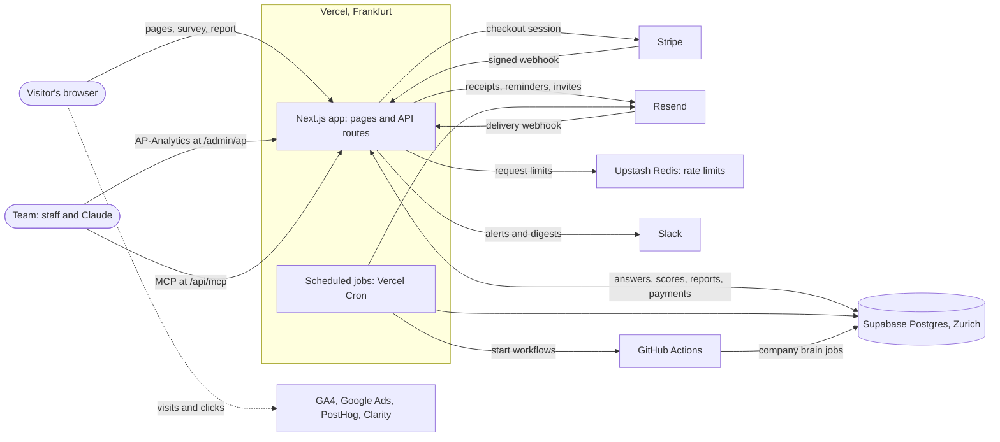
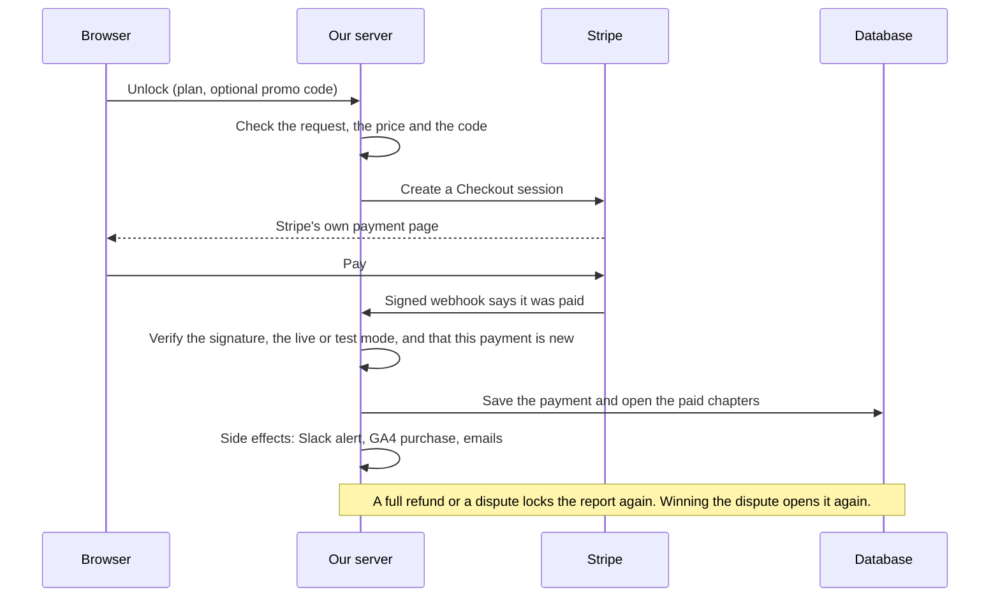
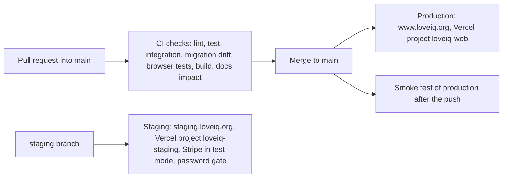

# Architecture

> **Last verified:** 2026-10-27 | **Verified against:** `origin/main` at `3ca54753`: `app/`, `features/`, `shared/`, `vercel.json`, `.github/workflows/`, `supabase/migrations/`, `package.json`, `proxy.ts`

## Pattern Overview

**Overall:** A full-stack web product: Next.js 16 App Router on Vercel, a Supabase Postgres database, Stripe payments and scheduled jobs. It began as a marketing site and is no longer one.

**Key Characteristics:**

- The product is an assessment funnel: landing page, free survey, scoring, a report that opens by payment, then reminders, partner invites and sharing
- Server-side rendering for pages, client components for interactivity
- Route handlers under `app/api/` for everything that writes. Public form routes check CSRF (double-submit cookie), rate limit and validate with Zod; webhooks check a signature; scheduled-job routes check a bearer secret
- Rate limits live in Upstash Redis (Vercel KV), with an in-memory fallback when no store is configured (local development, and the staging project, which has none on purpose)
- No end-user accounts: a report opens through its private link. Staff sign in to AP-Analytics with a Supabase Auth magic link, limited to the `admin_users` email allowlist
- Payments are settled by signed Stripe webhooks, never by the browser
- Feature switches (the `system_flags` table) turn a feature on or off without a release
- Scheduled jobs (Vercel Cron, see `vercel.json`) send reminders, import company data and post digests

## Where it runs

- **Server functions:** Vercel region `fra1` (Frankfurt), pinned in `vercel.json` (`"regions": ["fra1"]`).
- **Database:** Supabase, region `eu-central-2` (Zurich).
- **Why the region matters for speed:** `/api/report` makes about seven database calls one
  after another. Until 2026-09-08 `vercel.json` set no region, so functions ran in Vercel's
  default `iad1` (Washington DC) and every one of those calls crossed the Atlantic. Pinning
  `fra1` cut the report's time to first byte from about 2.9 s to about 0.9 s.
- **How to check:** the `x-vercel-id` response header names the edge region, then the
  function region: `fra1::fra1::…` is right, `fra1::iad1::…` means the pin was lost.

## The system in one picture

Who talks to whom. The app and the scheduled jobs run on Vercel in Frankfurt and share one Postgres database in Zurich.



## The parts

| Part               | What it does                                                                                                                 | Where it lives                                                                                      |
| ------------------ | ---------------------------------------------------------------------------------------------------------------------------- | --------------------------------------------------------------------------------------------------- |
| Website            | The pages visitors see: landing, survey, report, checkout, about, glossary, legal                                            | `app/`, `features/*/ui/`                                                                            |
| Survey engine      | Takes the answers, saves drafts as people go, blocks bots, limits floods                                                     | `features/survey/`, `app/api/survey/`                                                               |
| Scoring engine     | Turns the answers into a match score for each of the 14 archetypes. Fixed rules, no AI                                       | `features/scoring/`                                                                                 |
| Report engine      | Builds each report from written text. Opens or locks chapters by what was paid                                               | `features/report/`, `app/api/report/`                                                               |
| Checkout engine    | Starts a Stripe payment and opens the report when Stripe confirms. A full refund or a dispute locks it again                 | `features/checkout/`, `features/pricing/`, `features/pay-to-start/`, `app/api/stripe/`              |
| Email engine       | Receipts, reminders, partner invites, unlock feedback. Stops mailing bounced or complaining addresses and honors unsubscribe | `shared/emails/`, `features/invite/`, `features/unlock-feedback/`, `app/api/resend/webhook/`        |
| Database           | Answers, scores, reports, payments, emails, events and the company memory                                                    | `supabase/migrations/`                                                                              |
| Feature switches   | Turn a feature on or off without a release                                                                                   | `shared/flags/`, `app/api/admin/system-flags/`                                                      |
| Safety layer       | CSRF, rate limits, bot checks, strict browser rules (CSP), signed webhooks                                                   | `proxy.ts`, `shared/http/`                                                                          |
| Measuring tools    | Visits, clicks, recordings, client errors, sales. See "Measuring" below                                                      | `features/analytics/`, `features/attribution/`                                                      |
| AP-Analytics       | Team-only pages for traffic, funnels, payments and feedback. Sign-in by emailed link                                         | `features/admin/`, `app/admin/ap/`                                                                  |
| Company brain      | Jarvis: a searchable memory of what the team writes. Answers inside Claude over MCP and lists the sources it used            | `features/brain/`, `app/api/mcp/`, [`docs/runbooks/COMPANY_BRAIN.md`](../runbooks/COMPANY_BRAIN.md) |
| UX checks          | Turn session recordings and behaviour signals into evidence, or refuse to                                                    | `features/ux-review/`, `features/ux-signals/`                                                       |
| Assessment Factory | Published psychometric instruments beyond the main survey                                                                    | `features/assessments/`                                                                             |
| Automation         | Scheduled jobs and GitHub Actions workflows                                                                                  | `vercel.json`, `.github/workflows/`                                                                 |

Most feature folders under `features/` have an `AGENT_README.md` that says what the folder is for.

## Measuring

What runs in the visitor's browser, and what the cookie banner (CookieYes) controls:

- **Follows the banner:** Google Analytics 4 and Google Ads (`app/layout.tsx`). They send nothing until the visitor accepts.
- **Runs on all visits** (disclosed in the privacy policy): Microsoft Clarity for heatmaps and recordings, and PostHog for events, recordings and client errors.
- **First party, not gated:** report-engagement events (an allowlist, once a report is open) are written to our own `analytics_event` table without waiting for the banner. Since 2026-09-18 that write sets no cookie and sends nothing to a third party (see the comment above `persistAnalyticsEvent` in `features/analytics/client.ts`).
- **Production only:** the GA4, Google Ads, Tag Manager and Clarity scripts are not emitted on staging or local builds (`isProductionSite()` in `shared/env/is-non-prod-deploy.ts`).
- **Sales also come from the server:** the Stripe webhook sends a `purchase` event to GA4 when the buyer consented (see [`INTEGRATIONS.md`](INTEGRATIONS.md)).

## The payment path

From the tap on Unlock to an open report. The price and any discount code are checked on our server: the browser can ask, but it cannot set the price.



## How a change goes live

Production and staging are separate Vercel projects with separate Supabase projects. See [`docs/runbooks/STAGING_DATABASE.md`](../runbooks/STAGING_DATABASE.md) for staging.



- Risky features ship switched off and a flag turns them on, so a merge and a launch are separate steps.
- Scheduled jobs run what is on `main`, so a merge is live at their next run.
- GitHub's own schedule starts Actions jobs hours late, so an hourly Vercel Cron (`/api/cron/start-github-jobs`) starts the jobs that are due.

## Where AI is used

- **In the product: nowhere.** The survey, scoring, report text and checkout call no language model. Scores come from fixed rules in `features/scoring/`, and report chapters are written text.
- **Company brain.** `features/brain/` is the only app code that calls a language model. `features/brain/server/llm.ts` calls an HTTP API (`BRAIN_LLM_BASE_URL` picks the provider: Google's Gemini API by default, or Anthropic's) or, when `BRAIN_LLM_CLI=claude`, the `claude` command line. `features/brain/server/night-shift.ts` and `features/brain/server/ingest/slack-media.ts` run `claude -p` themselves. The meaning index (embeddings) is computed inside Supabase with `gte-small`: no API key and no third party.
- **Claude Code in GitHub Actions.** `generate-fix.yml`, `persona-walkers.yml` (its judge step) and `brain-daily.yml` run Claude Code on the team subscription. A proposed fix arrives as a pull request marked as written by Claude Code, for a person to read and merge.
- **Claude as the front door.** People ask in claude.ai or Claude Code, which reach the brain over MCP at `/api/mcp`.

## Scale on 2026-10-27

A snapshot of `origin/main` at `3ca54753`. Counts change daily, so re-count before quoting one.

| What                | Count |
| ------------------- | ----- |
| Pages               | 38    |
| API routes          | 105   |
| Database migrations | 311   |
| Database tables     | ~98   |
| Scheduled jobs      | 30    |
| GitHub workflows    | 22    |
| Test files          | 735   |

From the repo root:

```bash
git ls-files | grep -cE '^app/.*page\.tsx$'                # pages
git ls-files | grep -cE '^app/api/.*route\.ts$'            # API routes
git ls-files | grep -cE '^supabase/migrations/.*\.sql$'    # migrations
git ls-files | grep -cE '^\.github/workflows/.*\.ya?ml$'   # workflows
git ls-files | grep -cE '\.(test|spec)\.(ts|tsx|mjs)$'     # test files
node -e 'console.log(require("./vercel.json").crons.length)'   # scheduled jobs
git grep -h -o -i -E 'create table( if not exists)? +(public\.)?"?[a-z_]+"?' -- supabase/migrations | sed -E 's/create table( if not exists)? +(public\.)?//I; s/"//g' | tr 'A-Z' 'a-z' | sort -u | wc -l   # tables created (some may have been dropped since)
```

## Layers

**Pages Layer (App Router):**

- Purpose: Define routes and page-level layouts
- Contains: Page components that compose UI sections
- Location: `app/` directory
- Depends on: Component layer
- Used by: Next.js routing

**Component Layer:**

- Purpose: Reusable UI components organized by feature
- Contains: React components (Server + Client)
- Location: `features/*/ui/` directories (one per feature)
- Features: one folder per feature under `features/`; see "The parts" above and [`STRUCTURE.md`](STRUCTURE.md)
- Depends on: CSS custom properties (globals.css), Tailwind CSS
- Used by: Pages

**API Layer:**

- Purpose: Server-side form processing and utilities
- Contains: Route handlers for POST/GET requests
- Location: `app/api/` directory
- Depends on: External services (Supabase, Resend, Slack), lib utilities
- Used by: Client-side form submissions

**Library Layer:**

- Purpose: Shared utilities and helpers
- Contains: Analytics, CSRF, rate limiting, circuit breaker, logging, email helpers, admin auth/roles
- Location: `shared/*` (cross-cutting) plus `features/*/server` and `features/*/logic` (feature-owned)
- Key files: `features/analytics/client.ts`, `shared/http/csrf.ts`, `shared/http/ratelimit.ts`, `shared/http/circuit-breaker.ts`, `shared/observability/logger.ts`, `shared/http/fetch-with-timeout.ts`
- Subtrees: `shared/http/`, `shared/observability/`, `shared/auth/`, `shared/url/`, `shared/format/`, `shared/emails/`, `shared/ui/`; `features/admin/server/` (auth, roles, audit, Supabase helpers)
- Depends on: External APIs, Supabase
- Used by: Components, API routes, middleware

**Middleware Layer:**

- Purpose: Security headers, CSRF cookie management, request logging
- Contains: CSP directives, CSRF token generation, security logging
- Location: `proxy.ts`
- Used by: All requests

## Data Flow

**Landing Page Load:**

1. User navigates to `/`
2. Next.js renders `app/page.tsx` (Server Component)
3. `LandingPageWhite` composes all sections (the `W*` components under `features/landing/ui/white/`)
4. Client components hydrate for interactivity
5. Smooth scroll initialized (Lenis)
6. Google Analytics tracks page view

**Contact Form Flow:**

1. User fills contact form on About page
2. reCAPTCHA verification on client
3. POST to `/api/contact` with captcha token
4. CSRF token verification
5. Rate limiting check (Redis-backed)
6. Server validates with Zod schema
7. Server-side reCAPTCHA verification
8. Send email via Resend to team
9. Notify Slack webhook
10. Return success response

**Survey Submission Flow:**

1. User completes survey on `/survey`
2. POST to `/api/survey`
3. CSRF token verification
4. Rate limiting check (IP-based, Redis-backed)
5. Server validates with Zod schema
6. Honeypot check (bot detection)
7. Email cooldown check (5 min per email)
8. Submit via Supabase RPC (`submit_survey`)
9. Notify Slack webhook (after response)
10. Return success response
11. Client shows success animation (3s)
12. Auto-transitions to PreReportWizard (6 slides; the second is the report map)
13. User completes wizard → opens the report (`/report/<token>`, Report 3.0 by default)

**State Management:**

- Stateless - No persistent client state
- Form state managed locally in components
- No global state management (Redux, Context)
- Server state: Database (Supabase) for survey submissions, reports, payments and historical waitlist_user data; rate limits live in Redis

## Key Abstractions

**Section Components:**

- Purpose: Self-contained page sections
- Examples: `WHero`, `WArchetypes`, `WFAQ`, `WCTA`
- Pattern: Functional components with Tailwind styling
- Location: `features/landing/ui/*.tsx`, `features/about/ui/*.tsx`

**API Route Handlers:**

- Purpose: Server-side form processing
- Examples: `app/api/contact/route.ts`, `app/api/survey/route.ts`, `app/api/invite/route.ts`
- Pattern: Next.js Route Handlers with CSRF + rate limiting + Zod validation
- Features: CSRF protection, Redis-backed rate limiting, validation, honeypot

**Analytics Helpers:**

- Purpose: Typed event tracking
- Examples: `track()`, `trackStartSurvey()`, `trackSurveyComplete()`
- Pattern: Wrapper functions around gtag
- Location: `features/analytics/client.ts`

## Entry Points

**Main Entry:**

- Location: `app/layout.tsx`
- Triggers: All page navigations
- Responsibilities: Root layout, fonts, metadata, scripts, analytics

**Page Routes:**

Not exhaustive: every page is an `app/**/page.tsx`.

- `/` - `app/page.tsx` → `LandingPage`
- `/about` - `app/about/page.tsx` → `AboutPage`
- `/survey` - `app/survey/page.tsx` → `SurveyPage`
- `/glossary` - `app/glossary/page.tsx` → Glossary index
- `/glossary/[slug]` - `app/glossary/[slug]/page.tsx` → Glossary term
- `/trust-zone` - `app/trust-zone/page.tsx`
- `/login` - `app/login/page.tsx` → Staging login
- `/admin/ap` - `app/admin/ap/page.tsx` → AP-Analytics Dashboard (Supabase Auth protected), with its other pages under `app/admin/ap/`; since 2026-10-16 the admin is AP-Analytics only, and `/admin` and the old admin pages redirect here
- `/admin/login` - `app/admin/login/page.tsx` → Admin magic link login
- `/privacy-policy`, `/terms-of-use`, `/terms-and-conditions`, `/medical-disclaimer`, `/digital-content-terms`, `/cookies`, `/imprint` - Legal pages

**API Routes:**

Not exhaustive. Every public route is listed in [`docs/api.md`](../api.md) and every admin route in [`docs/admin-api.md`](../admin-api.md); `npm run docs:truth` fails when they drift from the code.

- `/api/contact` - `app/api/contact/route.ts`
- `/api/survey` - `app/api/survey/route.ts`
- `/api/health` - `app/api/health/route.ts`
- `/api/staging-login` - `app/api/staging-login/route.ts` (staging only)
- `/api/staging-logout` - `app/api/staging-logout/route.ts` (staging only)
- `/api/admin/*` - Admin API routes (login, logout, the AP-Analytics feeds under `ap/`, and the API-only data-subject, submissions/[id], system-flags and digest-image)
- `/admin/auth/callback` - `app/admin/auth/callback/route.ts` (Supabase Auth magic link callback)

**SEO Routes:**

- `/robots.txt` - `app/robots.ts`
- `/sitemap.xml` - `app/sitemap.ts`

## Error Handling

**Strategy:** Try/catch in API routes, graceful degradation in UI

**Patterns:**

- API routes return JSON with `error` field on failure
- Rate limiting returns 429 status
- CSRF failure returns 403 status
- Validation errors return 400 status
- External service errors return 500 status
- Structured logging via pino (`shared/observability/logger.ts`)

## Cross-Cutting Concerns

**Logging:**

- pino structured logging (`shared/observability/logger.ts`)
- Slack notifications for important events (survey submissions, contact submissions, payments)
- @vercel/otel for OpenTelemetry integration

**Validation:**

- Zod schemas at API boundary (`app/api/*/route.ts`)
- No client-side validation library

**Security:**

- CSRF protection via double-submit cookie (`shared/http/csrf.ts`, `proxy.ts`)
- Rate limiting (IP-based, Upstash Redis via `shared/http/ratelimit.ts`, in-memory fallback when no store is configured)
- Honeypot fields for bot detection
- reCAPTCHA for contact form
- Strict CSP headers in `proxy.ts`
- Input sanitization via Zod
- Fetch timeout wrapper (`shared/http/fetch-with-timeout.ts`)
- Circuit breaker pattern (`shared/http/circuit-breaker.ts`)

**SEO:**

- Structured data (Organization, Website, FAQ schemas)
- Open Graph and Twitter meta tags
- Sitemap and robots.txt generation

---

_Last updated: 2026-10-27_
_Update when major patterns change_
