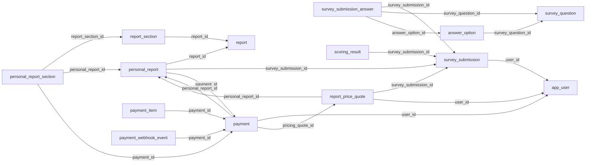

# Database tables

<!-- cspell:disable -->

> **Generated:** 2026-10-27 | **Source:** the live schema (PostgREST OpenAPI) | 98 relations, 1031 columns, 72 foreign keys

A map of every table and view the API exposes. It is generated, so it matches production on the day shown. Rebuild it with `node scripts/generate-table-map.mjs` (read-only; needs the Supabase URL and service key).

"Points to" means this relation has a column that holds the id of a row in that one (a foreign key). The page does not show nullability, unique constraints (so a 1:1 link looks like a 1:N one) or row-level security. Read `supabase/migrations/` for those.

## The core path

One reader, from the survey to a paid report. Each arrow is a foreign key, labelled with its column.

## Survey and scoring (16)

| Relation                           | Columns | Points to                                               | What it holds                  |
| ---------------------------------- | ------- | ------------------------------------------------------- | ------------------------------ |
| `answer_option`                    | 7       | `survey_question`                                       |                                |
| `app_user`                         | 9       | `user_profile`                                          |                                |
| `scoring_result`                   | 13      | `survey_submission`                                     |                                |
| `submission_tag`                   | 5       |                                                         |                                |
| `submission_tag_assignment`        | 5       | `submission_tag`, `survey_submission`                   |                                |
| `survey`                           | 12      | `report`                                                |                                |
| `survey_behavior_event`            | 14      |                                                         |                                |
| `survey_partial_save`              | 9       |                                                         |                                |
| `survey_question`                  | 15      |                                                         |                                |
| `survey_question_kpi`              | 12      | `survey`, `survey_question`                             |                                |
| `survey_question_mapping`          | 3       | `survey`, `survey_question`                             |                                |
| `survey_submission`                | 19      | `app_user`, `survey`                                    |                                |
| `survey_submission_answer`         | 12      | `answer_option`, `survey_question`, `survey_submission` | One row per answered question. |
| `survey_submission_answer_history` | 8       | `survey_submission_answer`                              |                                |
| `survey_submission_answer_options` | 4       | `answer_option`, `survey_submission_answer`             |                                |
| `user_profile`                     | 14      |                                                         |                                |

## Reports (11)

| Relation                  | Columns | Points to                                          | What it holds                                                                                                |
| ------------------------- | ------- | -------------------------------------------------- | ------------------------------------------------------------------------------------------------------------ |
| `personal_report`         | 18      | `payment`, `report`, `survey_submission`           |                                                                                                              |
| `personal_report_section` | 11      | `payment`, `personal_report`, `report_section`     |                                                                                                              |
| `report`                  | 11      |                                                    |                                                                                                              |
| `report_access_email`     | 5       | `personal_report`                                  |                                                                                                              |
| `report_access_token`     | 6       | `survey_submission`                                |                                                                                                              |
| `report_section`          | 12      | `report`                                           |                                                                                                              |
| `report_section_feedback` | 11      | `app_user`, `personal_report`, `survey_submission` |                                                                                                              |
| `report_section_kpi`      | 15      | `report`, `report_section`                         |                                                                                                              |
| `report_section_rating`   | 5       | `personal_report_section`                          |                                                                                                              |
| `report_share`            | 11      | `app_user`, `personal_report`                      |                                                                                                              |
| `unlock_feedback`         | 23      | `payment`, `personal_report`, `survey_submission`  | The "why didn't you unlock?" email and its answer: one row per reader, claimed by the send before it emails. |

## Payments and prices (6)

| Relation                         | Columns | Points to                                           | What it holds                                                                                                 |
| -------------------------------- | ------- | --------------------------------------------------- | ------------------------------------------------------------------------------------------------------------- |
| `payment`                        | 30      | `app_user`, `personal_report`, `report_price_quote` |                                                                                                               |
| `payment_item`                   | 9       | `payment`                                           |                                                                                                               |
| `payment_webhook_event`          | 11      | `payment`                                           |                                                                                                               |
| `prepaid_report_access`          | 21      | `payment`, `survey_submission`                      |                                                                                                               |
| `report_price_quote`             | 40      | `app_user`, `personal_report`, `survey_submission`  |                                                                                                               |
| `report_price_quote_arm_history` | 14      | `report_price_quote`                                | Every change to a price quote's arm (experiment_group) or list price (msrp, starting_price), one row each,... |

## Events and analytics (7)

| Relation                        | Columns | Points to                                                            | What it holds                                         |
| ------------------------------- | ------- | -------------------------------------------------------------------- | ----------------------------------------------------- |
| `analytics_event`               | 11      | `app_user`, `personal_report`, `report_session`, `survey_submission` |                                                       |
| `digest_recommendation_history` | 8       |                                                                      | Weekly Slack-digest recommendation history.           |
| `funnel_event`                  | 8       |                                                                      | Top-of-funnel signals that predate survey_submission. |
| `marketing_spend`               | 11      |                                                                      |                                                       |
| `product_changelog`             | 13      |                                                                      |                                                       |
| `report_session`                | 8       | `app_user`, `personal_report`                                        |                                                       |
| `user_interactions`             | 9       | `app_user`                                                           |                                                       |

## Email and invites (6)

| Relation                 | Columns | Points to                              | What it holds                                                                                                  |
| ------------------------ | ------- | -------------------------------------- | -------------------------------------------------------------------------------------------------------------- |
| `booking_event`          | 11      | `personal_report`, `survey_submission` |                                                                                                                |
| `email_experiment_event` | 6       |                                        | Daily per-arm counters for the email A/B tests.                                                                |
| `email_message_event`    | 5       | `survey_submission`                    | Each nurture email's delivery, opens and clicks: the first of each kind per email, from the Resend webhook,... |
| `email_suppression`      | 5       |                                        |                                                                                                                |
| `invite_event`           | 6       |                                        |                                                                                                                |
| `resend_webhook_event`   | 4       |                                        |                                                                                                                |

## Company brain (9)

| Relation                  | Columns | Points to | What it holds                                                                                                  |
| ------------------------- | ------- | --------- | -------------------------------------------------------------------------------------------------------------- |
| `brain_chunk`             | 13      |           | Company-brain corpus.                                                                                          |
| `brain_decision_conflict` | 10      |           | Pairs of recorded decisions that cannot both stand, found by the decision radar and open until a person set... |
| `brain_mine_log`          | 4       |           | One row per meeting document the decision miner has read.                                                      |
| `brain_person`            | 7       |           |                                                                                                                |
| `brain_query`             | 18      |           | What the team asked the brain.                                                                                 |
| `brain_radar_topic`       | 3       |           | Which decision topics the radar has checked, against which set of decision ids.                                |
| `brain_refusal_log`       | 4       |           | Documents an ingester read and deliberately did not index, with the version refused, so an unchanged one is... |
| `brain_sweep_state`       | 2       |           |                                                                                                                |
| `brain_title_stopword`    | 4       |           | Structural title words brain_search skips.                                                                     |

## Admin and AP-Analytics (31)

| Relation                          | Columns | Points to                               | What it holds |
| --------------------------------- | ------- | --------------------------------------- | ------------- |
| `admin_action_item`               | 17      |                                         |               |
| `admin_alert_rule`                | 13      |                                         |               |
| `admin_ap_saved_filter`           | 7       |                                         |               |
| `admin_audit_log`                 | 8       |                                         |               |
| `admin_chart_annotation`          | 6       |                                         |               |
| `admin_competitive_watch`         | 13      |                                         |               |
| `admin_dashboard_subscription`    | 12      |                                         |               |
| `admin_decision_entry`            | 17      | `admin_experiment`, `product_changelog` |               |
| `admin_experiment`                | 27      | `admin_segment`                         |               |
| `admin_experiment_metric`         | 6       | `admin_experiment`                      |               |
| `admin_export_preset`             | 6       |                                         |               |
| `admin_field_note`                | 6       |                                         |               |
| `admin_goals`                     | 10      |                                         |               |
| `admin_investigation_case`        | 16      | `admin_segment`, `survey_submission`    |               |
| `admin_metric_benchmark`          | 15      |                                         |               |
| `admin_metric_dependency`         | 9       |                                         |               |
| `admin_metric_registry`           | 19      |                                         |               |
| `admin_metric_status`             | 12      |                                         |               |
| `admin_note`                      | 6       | `survey_submission`                     |               |
| `admin_research_repository_entry` | 19      | `admin_action_item`                     |               |
| `admin_research_taxonomy_term`    | 13      |                                         |               |
| `admin_resource_comment`          | 7       |                                         |               |
| `admin_review_request`            | 17      |                                         |               |
| `admin_saved_view`                | 6       |                                         |               |
| `admin_segment`                   | 9       |                                         |               |
| `admin_strategy_bet`              | 14      |                                         |               |
| `admin_strategy_initiative`       | 15      | `admin_goals`                           |               |
| `admin_submission_facts` (view)   | 18      | `app_user`                              |               |
| `admin_tag_rules`                 | 8       | `submission_tag`                        |               |
| `admin_users`                     | 5       |                                         |               |
| `ap_team_user` (view)             | 1       |                                         |               |

## Waitlist (retired) (3)

| Relation           | Columns | Points to                   | What it holds |
| ------------------ | ------- | --------------------------- | ------------- |
| `waitlist_mapping` | 3       | `app_user`, `waitlist_user` |               |
| `waitlist_signups` | 4       |                             |               |
| `waitlist_user`    | 7       |                             |               |

## Operations (9)

| Relation                   | Columns | Points to | What it holds                                                                                                  |
| -------------------------- | ------- | --------- | -------------------------------------------------------------------------------------------------------------- |
| `cron_run`                 | 7       |           | Per-cron run history.                                                                                          |
| `data_subject_request_log` | 9       |           |                                                                                                                |
| `rate_limits`              | 3       |           |                                                                                                                |
| `slack_alert_sent`         | 7       |           | Cross-deploy dedup for cron-emitted Slack alerts.                                                              |
| `slack_dead_letter`        | 8       |           |                                                                                                                |
| `slack_journey_message`    | 8       |           | Slack message id per survey submission, so milestone updates edit the original notification instead of post... |
| `system_flags`             | 5       |           |                                                                                                                |
| `ux_finding`               | 21      |           | One row per UX-review observation the verifier answered, with the probe results and what the run was pointe... |
| `ux_walk_record`           | 8       |           | Persona walks the UX checker proves its measures on: each walk's events and what it knows it did.              |
